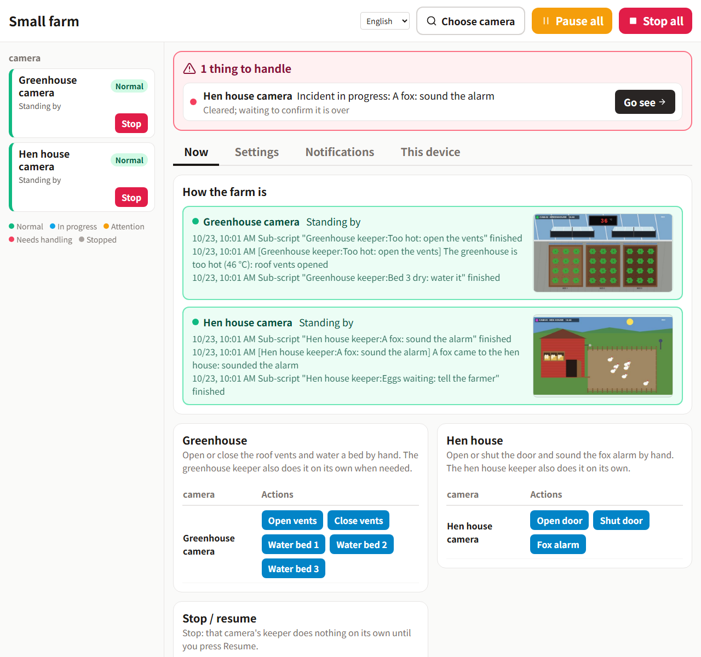

# Inspector demo: a small farm

A simulated farm with two cameras, to try [Inspector](https://github.com/wrbyhaquc/inspector) without a real farm.
It runs on your own computer; the "cameras" are pictures the simulator draws, and the "equipment" (roof vents,
sprinklers, the hen house door, a fox alarm) are switches Inspector can turn through an HTTP output - the way it
would drive real devices.

English · [繁體中文](README.zh-TW.md)


*Nobody touched anything in this clip: Inspector watched both cameras and ran the equipment through the pack below.*

## What happens on the farm

Time runs fast (by default one day takes 6 minutes).

| Camera | What you see | What is going on | What should be done |
|---|---|---|---|
| Greenhouse | The red digits on the wall display | The temperature: the sun heats the greenhouse, much more with the roof vents shut | Open the vents when it gets too hot, close them when it has cooled down |
| Greenhouse | Pale soil, yellow and then brown plants in one bed | That bed is drying out (each dries at its own pace, faster when hot) | Water that bed only |
| Hen house | Hens in the run, the door open or shut | Hens go out after dawn and walk back in at dusk by themselves | Open the door in the morning; shut it at night once every hen is inside |
| Hen house | Eggs on the straw in the nest boxes | Each hen lays one a morning | Tell someone to collect them |
| Hen house | An orange fox outside the fence | At night it takes a hen still outside, or one through an open door | Sound the alarm: it runs off |

## Run it

Needs Python 3.10+ and Pillow (`pip install pillow`; Inspector already has it).

```bash
python sim/server.py            # http://127.0.0.1:8810/
```

| Address | |
|---|---|
| `http://127.0.0.1:8810/` | The control room: both cameras, the equipment switches, demo buttons (day, dusk, night, heat wave, a dry bed, a fox, eggs, speed) |
| `http://127.0.0.1:8810/greenhouse/video.mjpg` | The greenhouse camera as an MJPEG stream: in Inspector, "Sources › + Add source › Stream › HTTP" |
| `http://127.0.0.1:8810/coop/video.mjpg` | The hen house camera |
| `http://127.0.0.1:8810/<camera>/snapshot.jpg` | One picture |
| `POST http://127.0.0.1:8810/api/command` | `{"command": "vents_open"}` - also `vents_close`, `water` (with `"value": 1`, `2` or `3`: the bed), `door_open`, `door_close`, `alarm`. Exactly what an Inspector HTTP output sends |
| `http://127.0.0.1:8810/api/state` | The simulator's own numbers, for checking: Inspector itself only judges from the pictures |

Options: `--port`, `--fps` (pictures per second, default 5), `--day-minutes` (real minutes per simulated day),
`--seed` (the same events every run), `--host` (default 127.0.0.1: only this computer).

## Try it in 10 minutes

You need [Inspector](https://github.com/wrbyhaquc/inspector) installed (the Runtime is enough: no PyTorch, no model to train; a version that knows script spec 9, from October 2026 on) and this repository.

1. **Start the farm.** `python sim/server.py`, then open http://127.0.0.1:8810/ - the control room. Leave it running.
2. **Start Inspector.** `start.bat` (or `python -m server`) in the Inspector folder; it opens http://127.0.0.1:8765.
3. **Install the pack.** **Packs › Install or upgrade**, choose `pack/releases/farm-1.0.0.zip`
   (`farm-zh-1.0.0.zip` for the Chinese one) and let it become the running pack. Restart Inspector when it asks
   (the button on that page, or close it and start it again). From a command line instead:
   `python -m project.pack install pack/releases/farm-1.0.0.zip --activate` in the Inspector folder, then start it.
4. **Check the cameras.** **Sources** shows *Greenhouse camera* and *Hen house camera*: the pack brings their
   addresses, so nothing has to be typed. Running the simulator on another computer or port? Change them there.
5. **Run.** **Run › Start**. The pack has no trained model; every state is judged by screen rules (colours,
   reference pictures, the thermometer's digits), so it works straight away.
6. **Open the operation panel** (**Operation panel ↗**, also fine on a phone) and make things happen on the
   simulator's page:
   - **Heat wave** - the greenhouse heats up and the roof vents open; once it has cooled down they close again.
   - **Bed 2 dry** - only bed 2 is watered.
   - **Fox now** - the alarm sounds and the fox runs off.
   - **Lay 6 eggs** - the panel says it is time to collect them (once; **Collect** resets it).
   - **Dusk now** - the hens walk back in; once every hen is inside, the door shuts. **Day now** opens it again.

   The greenhouse buttons sit on the greenhouse camera's row of the panel and the hen house's on its own.
   **Settings** has the temperatures the vents open and close at; what you change there stays on your computer and
   survives installing a newer pack.



## What is in the pack

| | |
|---|---|
| Cameras | `GH-CAM` and `COOP-CAM`: the simulator's two streams, declared by the pack (`project.json` "sources") |
| States | `temperature` (read digits), `vents` and `door` (reference pictures), `bed1_dry` .. `bed3_dry`, `daylight`, `hens_out`, `eggs`, `fox` (colour rules) - `pack/states.json`, with the taught references in `pack/refs/` |
| One set of states, two cameras | `view_greenhouse` / `view_coop` read each camera's name tag; every other state is gated on one of them, so the greenhouse's states read "Other camera" on the hen house picture and the other way round |
| Output | `farm`: HTTP `POST` to the simulator's `/api/command` |
| Main scripts | *Greenhouse keeper* on the greenhouse camera only: too hot → vents open, cooled down → vents closed, a dry bed → water that bed. *Hen house keeper* on the hen house camera only: a fox → the alarm (urgent); night and every hen in → shut the door; day → open it; eggs waiting → tell the farmer once (a variable remembers) |
| Settings | the temperatures the vents open and close at (30 °C and 24 °C to begin with) |
| Sub-scripts | vents open / close, water bed 1 / 2 / 3, door open / shut, sound the alarm |
| Operation panel | both cameras and how they are, each camera's own buttons, stop / resume, what happened, the temperatures, notifications |

`pack/build.py` makes the pack through Inspector's own API (`--lang en` or `zh-TW`), and `python -m project.pack export`
(in the Inspector folder) turns it into the zip in `pack/releases/`. `tools/teach_refs.py` makes the reference pictures
from the simulator's drawing; `tools/check_states.py` checks every state against pictures of every situation the
simulator can draw (1,824 pictures, 21,888 answers, none wrong).

## License

Apache-2.0.
