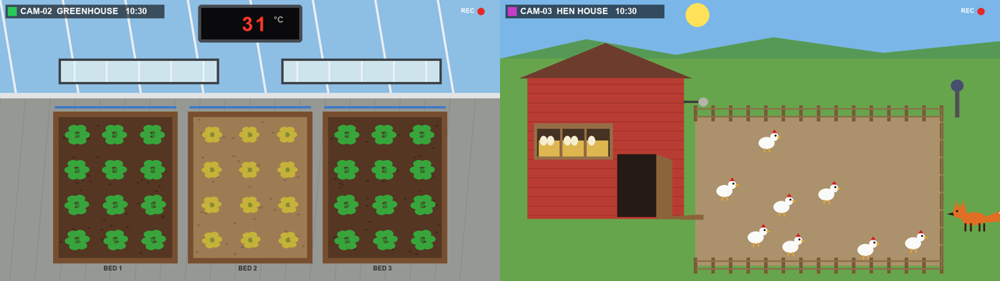

# Inspector 示範:小農場

一座附兩台攝影機的模擬農場,不用真的農場就能試用 [Inspector](https://github.com/wrbyhaquc/inspector)。
它在你自己的電腦上執行;「攝影機」是模擬器畫出來的畫面,「設備」(屋頂通風窗、灑水器、雞舍門、驅狐警報)是 Inspector 可以透過 HTTP 輸出切換的開關,就像控制真的設備一樣。

[English](README.md) · 繁體中文



## 農場裡會發生什麼

時間跑得比較快(預設一天 6 分鐘)。

| 攝影機 | 畫面上看到的 | 實際上是 | 該怎麼處理 |
|---|---|---|---|
| 溫室 | 牆上顯示器的紅色數字 | 溫度:太陽會曬熱溫室,通風窗關著時熱得更快 | 太熱就開通風窗,降溫後再關 |
| 溫室 | 某一畦的土變淺色、菜變黃再變褐色 | 那一畦快乾了(每畦乾的速度不同,天熱時更快) | 只澆那一畦 |
| 雞舍 | 運動場上的雞、門開著或關著 | 天亮後雞會出來,黃昏自己走回雞舍 | 早上開門;晚上確定雞都進去了再關門 |
| 雞舍 | 產蛋箱稻草上的蛋 | 每隻母雞早上下一顆 | 通知人來撿 |
| 雞舍 | 圍籬外的橘色狐狸 | 晚上會叼走還在外面的雞,門沒關的話也會進雞舍叼 | 響警報:牠會逃走 |

## 執行

需要 Python 3.10 以上與 Pillow(`pip install pillow`;裝了 Inspector 就已經有)。

```bash
python sim/server.py            # http://127.0.0.1:8810/
```

| 位址 | |
|---|---|
| `http://127.0.0.1:8810/` | 監控室:兩台攝影機、設備開關、示範用按鈕(白天、黃昏、晚上、熱浪、某畦變乾、狐狸、下蛋、時間速度) |
| `http://127.0.0.1:8810/greenhouse/video.mjpg` | 溫室攝影機的 MJPEG 串流:在 Inspector「來源 › + 加入來源 › 影像串流 › HTTP」 |
| `http://127.0.0.1:8810/coop/video.mjpg` | 雞舍攝影機 |
| `http://127.0.0.1:8810/<camera>/snapshot.jpg` | 一張畫面 |
| `POST http://127.0.0.1:8810/api/command` | `{"command": "vents_open"}`;另有 `vents_close`、`water`(加 `"value": 1`、`2` 或 `3`:第幾畦)、`door_open`、`door_close`、`alarm`。格式和 Inspector 的 HTTP 輸出送出的完全相同 |
| `http://127.0.0.1:8810/api/state` | 模擬器自己的數字,只給你核對用:Inspector 只看畫面判斷 |

參數:`--port`、`--fps`(每秒幾張,預設 5)、`--day-minutes`(模擬一天是真實幾分鐘)、`--seed`(每次發生同樣的事件)、`--host`(預設 127.0.0.1:只有這台電腦連得到)。

## 方案包

Inspector 在兩個畫面上要看的東西寫在 `pack/states.json`:溫度計的數字(「讀數字」規則,教好的數字在 `pack/refs/`)、通風窗和雞舍門(參考圖比對)、每畦的乾土、雞、蛋、狐狸和天色(顏色規則)。
每台攝影機左上角有自己的名稱標籤;一台攝影機的狀態在另一台的畫面上會是「另一台攝影機」,所以兩台共用一套狀態。
`tools/check_states.py` 用模擬器能畫出的每一種狀況檢查每個狀態。

完整的方案包(腳本、給農場主人的操作面板)接下來會放上來。

## 授權

Apache-2.0。
