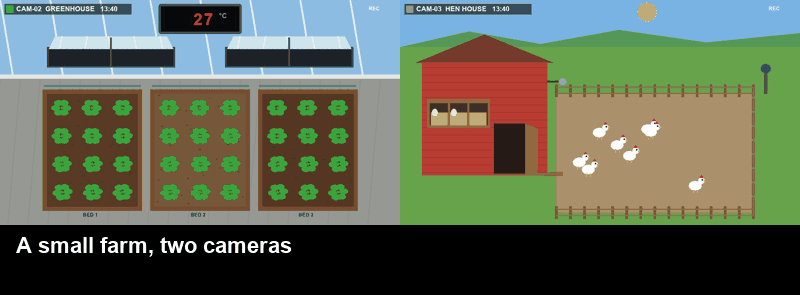
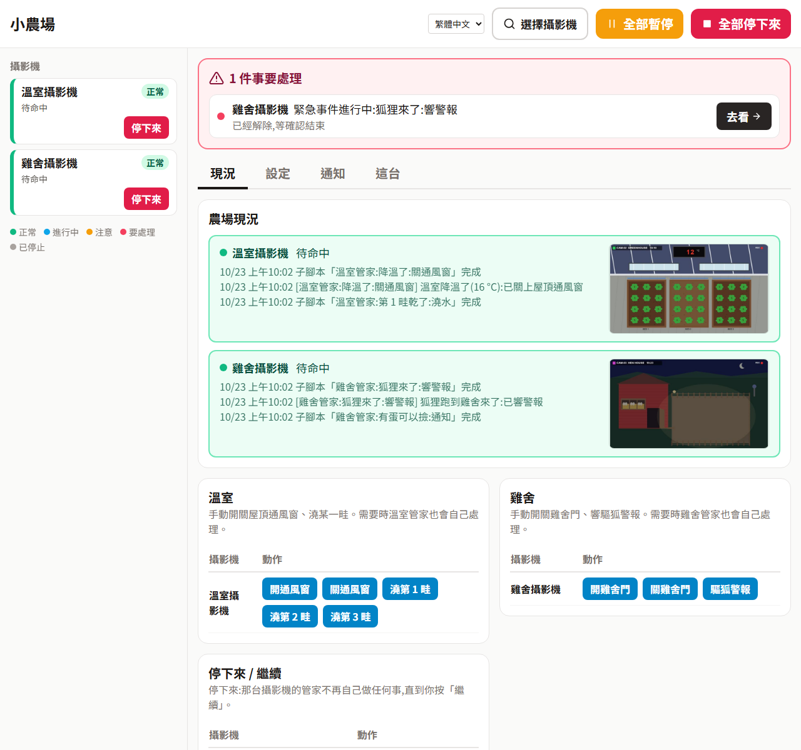

# Inspector 示範:小農場

一座附兩台攝影機的模擬農場,不用真的農場就能試用 [Inspector](https://github.com/wrbyhaquc/inspector)。
它在你自己的電腦上執行;「攝影機」是模擬器畫出來的畫面,「設備」(屋頂通風窗、灑水器、雞舍門、驅狐警報)是 Inspector 可以透過 HTTP 輸出切換的開關,就像控制真的設備一樣。

[English](README.md) · 繁體中文



*這段影片裡沒有人動手:Inspector 看兩台攝影機的畫面,透過下面的方案包操作設備。*

## 農場裡會發生什麼

時間跑得比較快(預設一天 6 分鐘)。

| 攝影機 | 畫面上看到的 | 實際上是 | 該怎麼處理 |
|---|---|---|---|
| 溫室 | 牆上顯示器的紅色數字 | 溫度:太陽會曬熱溫室,通風窗關著時熱得更快 | 太熱就開通風窗,降溫後再關 |
| 溫室 | 某一畦的土變淺色、菜變黃再變褐色 | 那一畦快乾了(每畦乾的速度不同,天熱時更快) | 只澆那一畦 |
| 雞舍 | 運動場上的雞、門開著或關著 | 天亮後雞會出來,黃昏自己走回雞舍 | 早上開門;晚上確定雞都進去了再關門 |
| 雞舍 | 產蛋箱稻草上的蛋 | 每隻母雞早上下一顆 | 通知人來撿 |
| 雞舍 | 圍籬外的橘色狐狸 | 晚上會叼走還在外面的雞,門沒關的話也會進雞舍叼 | 響警報:牠會逃走 |

## 執行

需要 Python 3.10 以上與 Pillow(`pip install pillow`;裝了 Inspector 就已經有)。

```bash
python sim/server.py            # http://127.0.0.1:8810/
```

| 位址 | |
|---|---|
| `http://127.0.0.1:8810/` | 監控室:兩台攝影機、設備開關、示範用按鈕(白天、黃昏、晚上、熱浪、某畦變乾、狐狸、下蛋、時間速度) |
| `http://127.0.0.1:8810/greenhouse/video.mjpg` | 溫室攝影機的 MJPEG 串流:在 Inspector「來源 › + 加入來源 › 影像串流 › HTTP」 |
| `http://127.0.0.1:8810/coop/video.mjpg` | 雞舍攝影機 |
| `http://127.0.0.1:8810/<camera>/snapshot.jpg` | 一張畫面 |
| `POST http://127.0.0.1:8810/api/command` | `{"command": "vents_open"}`;另有 `vents_close`、`water`(加 `"value": 1`、`2` 或 `3`:第幾畦)、`door_open`、`door_close`、`alarm`。格式和 Inspector 的 HTTP 輸出送出的完全相同 |
| `http://127.0.0.1:8810/api/state` | 模擬器自己的數字,只給你核對用:Inspector 只看畫面判斷 |

參數:`--port`、`--fps`(每秒幾張,預設 5)、`--day-minutes`(模擬一天是真實幾分鐘)、`--seed`(每次發生同樣的事件)、`--host`(預設 127.0.0.1:只有這台電腦連得到)。

## 10 分鐘試用

需要先裝好 [Inspector](https://github.com/wrbyhaquc/inspector)(Runtime 版就夠:不用 PyTorch,也不用訓練模型;要認得腳本規範第 9 版,2026 年 10 月以後的版本),再加上這個 repo。

1. **啟動農場。** `python sim/server.py`,打開 http://127.0.0.1:8810/ 監控室。讓它一直開著。
2. **啟動 Inspector。** 在 Inspector 資料夾執行 `start.bat`(或 `python -m server`),會打開 http://127.0.0.1:8765。
3. **安裝方案包。** **方案包 › 安裝或升級**,選 `pack/releases/farm-zh-1.0.0.zip`(英文版是 `farm-1.0.0.zip`),
   並設成執行中的方案包。依提示重新啟動 Inspector(用那一頁的按鈕,或關掉再開)。
   也可以用指令:在 Inspector 資料夾執行 `python -m project.pack install pack/releases/farm-zh-1.0.0.zip --activate`,再啟動。
4. **確認攝影機。** **來源** 頁會有「溫室攝影機」和「雞舍攝影機」:方案包已經帶好位址,不用自己輸入。
   模擬器在別台電腦或別的連接埠?在那裡改位址就好。
5. **開始執行。** **執行 › 開始**。這個方案包沒有訓練好的模型,每個狀態都用畫面規則(顏色、參考圖、溫度計的數字)判斷,所以馬上就能用。
6. **打開操作面板**(**操作面板(給使用者) ↗**,手機也能用),然後在模擬器頁面上製造狀況:
   - **Heat wave(熱浪)**:溫室變熱,屋頂通風窗會打開;降溫後再關上。
   - **Bed 2 dry(第 2 畦變乾)**:只會澆第 2 畦。
   - **Fox now(狐狸來了)**:響警報,狐狸逃走。
   - **Lay 6 eggs(下 6 顆蛋)**:面板通知該撿蛋了(只通知一次;按 **Collect** 撿走後重來)。
   - **Dusk now(立刻黃昏)**:雞走回雞舍,全部進去後門會關上。**Day now** 會再打開。

   溫室的按鈕只放在操作面板上溫室攝影機那一列,雞舍的按鈕放在雞舍那一列。
   **設定** 可以改通風窗開、關的溫度;你在那裡改的值存在你自己的電腦上,安裝新版方案包也會保留。



## 方案包裡有什麼

| | |
|---|---|
| 攝影機 | `GH-CAM` 和 `COOP-CAM`:模擬器的兩個串流,由方案包宣告(`project.json` 的 "sources") |
| 狀態 | `temperature`(讀數字)、`vents` 和 `door`(參考圖比對)、`bed1_dry` ~ `bed3_dry`、`daylight`、`hens_out`、`eggs`、`fox`(顏色比例):`pack/states.json`,教好的參考圖在 `pack/refs/` |
| 兩台攝影機共用一套狀態 | `view_greenhouse` / `view_coop` 看每台攝影機的名稱標籤;其他狀態都以其中一個當閘門,所以溫室的狀態在雞舍畫面上是「另一台攝影機」,反過來也一樣 |
| 輸出 | `farm`:以 HTTP `POST` 送到模擬器的 `/api/command` |
| 主腳本 | 「溫室管家」只在溫室攝影機:太熱 → 開通風窗,降溫 → 關通風窗,某一畦乾了 → 澆那一畦。「雞舍管家」只在雞舍攝影機:狐狸 → 響警報(緊急);晚上雞都進去了 → 關門;白天 → 開門;有蛋 → 通知一次(用變數記住) |
| 使用者設定 | 通風窗開、關的溫度(一開始是 30 °C 和 24 °C) |
| 子腳本 | 開 / 關通風窗、澆第 1 / 2 / 3 畦、開 / 關雞舍門、響警報 |
| 操作面板 | 兩台攝影機的現況、各自的設備按鈕、停下來 / 繼續、最近發生的事、溫度設定、通知 |

`pack/build.py` 透過 Inspector 自己的 API 做出這個方案包(`--lang en` 或 `zh-TW`),再用 `python -m project.pack export`(在 Inspector 資料夾)變成 `pack/releases/` 裡的 zip。
`tools/teach_refs.py` 用模擬器的畫面產生參考圖;`tools/check_states.py` 用模擬器能畫出的每一種狀況檢查每個狀態(1,824 張畫面、21,888 個答案,沒有錯)。

## 授權

Apache-2.0。
